# La matemática del sistema: por qué converge, qué estaba mal y cómo acelerarlo



Revisión de la parte numérica del proyecto (`cpp/src/jacobi.cpp`,
`solver.py`, `coordinador.py`, `problema.py`). Todos los números salen de
[`experimentos_convergencia.py`](experimentos_convergencia.py) (placa 40×40,
n = 1 600, 4 bloques de 400 filas, tolerancia global `1e-8`), que corre en ~6 s:

```bash
python docs/experimentos_convergencia.py
```

---

## 1. El método en una línea

Partimos `A = M − N`, con `M` = la diagonal por bloques de `A` (un bloque `A_BB`
por esclavo) y `N` = todo lo que queda afuera (los acoples entre bloques):

```
x^(k+1) = M⁻¹ (N·x^(k) + b)        ⇔   A_BB · x_B^(k+1) = b_B − A_B,ext · x_ext^(k)   para cada B
```

El error evoluciona como `e^(k+1) = (M⁻¹N)·e^(k)`, así que **converge para todo
`x⁰` si y sólo si `ρ(M⁻¹N) < 1`**, y la cantidad de rondas es aproximadamente
`ln(tol) / ln ρ`.

Pero el esclavo no resuelve `A_BB` exactamente: le aplica `m` barridos de Jacobi
puntual (`--max-internas`). Con `A_BB = D − L_B` y `P = D⁻¹L_B`, la iteración que
realmente corre es **Jacobi en dos etapas**:

```
x^(k+1) = T_m · x^(k) + c,        T_m = P^m + (I − P^m) · M⁻¹N
```

Esta fórmula es la clave para entender `--max-internas`:

* `m = 1` → `T_1 = D⁻¹(D − A)`: **Jacobi puntual** (el "Jacobi clásico distribuido" del CLI).
* `m → ∞` → `T_∞ = M⁻¹N`: **Jacobi por bloques** exacto.
* En el medio, en la placa, `ρ(T_m)` baja de un extremo al otro a medida que crece `m`:

| m | 1 | 2 | 5 | 10 | 20 | 50 | 100 | 500 |
|---|---|---|---|---|---|---|---|---|
| ρ(T_m) | 0,99707 | 0,99431 | 0,98707 | 0,97798 | 0,96692 | 0,95465 | 0,94967 | 0,94780 |

---

## 2. Por qué funciona

### 2.1 La placa es una M-matriz

La matriz del Laplaciano de 5 puntos tiene `a_ii = 4` y `a_ij ∈ {0, −1}`:

1. **Z-matriz**: fuera de la diagonal todo es `≤ 0`.
2. **Diagonal dominante débil**: en las filas interiores `4 = 1+1+1+1` (¡no estricta!);
   sólo las filas que tocan el borde cumplen `4 > 3` o `4 > 2`.
3. **Irreducible**: la grilla es conexa; desde cualquier celda se llega al borde.

(2) + (3) es dominancia diagonal **irreducible**, que junto con (1) implica que `A`
es una **M-matriz no singular**: `A⁻¹ ≥ 0` elemento a elemento. Además es simétrica,
así que también es definida positiva.

> Ojo: (2) sola **no alcanza**. `[[1,−1,0],[−1,1,0],[0,0,2]]` es débilmente
> dominante con una fila estricta y es singular; Jacobi no converge. Es el caso que
> `es_diagonal_dominante()` aceptaba antes de esta revisión (ver §3, F1).

### 2.2 Splitting regular ⇒ converge con cualquier partición

Para cualquier partición en bloques de filas:

* `M` (diagonal por bloques) es una submatriz principal de una M-matriz, así que es
  M-matriz: `M⁻¹ ≥ 0`.
* `N` sólo tiene los `−a_ij ≥ 0` de afuera de los bloques: `N ≥ 0`.

Eso es un **splitting regular** (Varga) y para ellos
`ρ(M⁻¹N) = ρ(A⁻¹N) / (1 + ρ(A⁻¹N)) < 1`. **Jacobi por bloques converge sin importar
cómo se corten las filas**: ningún `--tam-bloque` puede romperlo.

### 2.3 Bloques más grandes ⇒ menos rondas (teorema de comparación)

Si `N₂ ≤ N₁` (la partición 2 "mete más de A en M") entonces `ρ₂ ≤ ρ₁`. Agrandar
bloques nunca empeora:

| partición | ρ | rondas ≈ ln(1e-8)/ln ρ |
|---|---|---|
| Jacobi puntual (1 600 bloques de 1) | 0,99707 = cos(π/41) | 6 269 |
| 16 bloques de 100 | 0,98586 | 1 294 |
| 8 bloques de 200 | 0,97171 | 642 |
| **4 bloques de 400** | **0,94780** | **344** |
| 2 bloques de 800 | 0,91987 | 221 |

Es el compromiso de la descomposición de dominio: más bloques = más paralelismo
pero más rondas. (Son estimaciones asintóticas; con `x⁰ = 0` y el criterio de
residuo se miden algo menos: 4 849 y 284.)

### 2.4 Cualquier cantidad de barridos internos converge

Con `A` M-matriz, `T_m ≥ 0` y `ρ(T_m) < 1` **para todo `m ≥ 1`** (Frommer y Szyld,
*two-stage iterative methods*). Por eso el esclavo puede cortar en cualquier
momento (por tolerancia o por tope) sin poner en riesgo la convergencia global;
sólo cambia la velocidad.

### 2.5 La versión asíncrona también convergería

Como `T_m ≥ 0`, `ρ(|T_m|) = ρ(T_m) < 1`, que es la condición de Chazan–Miranker
para **iteraciones asíncronas**: el coordinador podría usar cada resultado apenas
llega, sin la barrera por iteración, y seguiría convergiendo (paso 3 de
"Próximos pasos" en REVISION.md).

### 2.6 Residuo chico ≠ error chico

El criterio de parada mira el residuo; lo que importa es el error. Se relacionan con
el número de condición:

```
‖x − x*‖ / ‖x*‖  ≤  κ(A) · ‖b − A·x‖ / ‖b‖,       κ₂(A) = 680,6 (placa 40×40)
```

Medido al terminar: residuo relativo `9,9e-9`, error relativo `1,2e-7` (12 veces, bien
debajo de la cota de 680). El error **absoluto** máximo, `9,2e-6` grados, es otra
magnitud: no se puede comparar directamente con un residuo relativo.

### 2.7 El residuo sale gratis

En el barrido `s_i = b_i − Σ_{j≠i} a_ij x_j`, se obtiene a la vez
`x_i^nuevo = s_i / a_ii` y `r_i = s_i − a_ii·x_i` (el residuo del `x` actual). El
núcleo C++ lo usa así: el residuo informado es exacto y no cuesta un producto extra.

---

## 3. Falencias encontradas

### F1 · `es_diagonal_dominante()` aceptaba matrices singulares — **corregido**

Pedía "débil en todas las filas y estricta en alguna", que no es condición suficiente
(contraejemplo de §2.1: devolvía `True`, la matriz es singular, `ρ(J) = 1`, y el
núcleo hace 1 000 barridos con `x` creciendo linealmente sin informar error).

Ahora verifica **dominancia diagonal débil encadenada** (WCDD): débil en todas las
filas y, desde cada fila, un camino en el grafo de `A` hasta una fila estricta (una
búsqueda en anchura hacia atrás desde las filas estrictas, `O(nnz)`). Con eso las
sumas de fila de `|J|ᵖ` quedan `< 1` para `p` grande, así que `ρ(|J|) < 1`. Además
`A` es una H-matriz, y para H-matrices el splitting por bloques es "H-compatible": la
condición garantiza Jacobi puntual, por bloques (cualquier partición), en dos etapas
y asíncrono. Siete casos nuevos en `tests/test_problema.py`.

### F2 · Barridos internos de más: entre 75 % y 95 % del cómputo no mejora nada

El esclavo usa `tol_interna = 1e-10` (más estricta que la global, `1e-8`) relativa a
`‖b_eff‖`, con tope de 500 barridos:

| criterio interno | rondas | barridos en el camino crítico |
|---|---|---|
| **actual**: tol 1e-10, máx 500 | 284 | **123 738** |
| exacto (sin tope) | 284 | 156 405 |
| m = 100 fijos | 288 | 29 088 |
| m = 20 fijos | 434 | 9 114 |
| m = 10 fijos | 646 | 7 106 |
| m = 5 fijos | 1 098 | **6 588** (mínimo) |
| m = 1 (Jacobi puntual) | 4 849 | 9 698 |
| relativo ‖r_B‖ ≤ 0,1·‖r_B⁰‖ | 330 | 15 332 |
| relativo ‖r_B‖ ≤ 0,03·‖r_B⁰‖ | 293 | 25 517 |

* Pasar de 100 a 500 barridos no ahorra rondas (288 → 284) y cuadruplica el cómputo.
* 296 de 1 136 trabajos tocan el tope sin "converger" (todos en las primeras 162 de
  284 rondas): el bloque
  se resuelve con mucha precisión respecto de un `x_ext` que todavía está lejos de la
  solución (*sobre-resolución*). La tolerancia interna útil es proporcional al
  residuo externo, no un `1e-10` fijo.
* El criterio **relativo al residuo inicial del bloque** (`‖r_B‖ ≤ θ‖r_B⁰‖`) es el
  estándar de los métodos inexactos y no depende de la escala de `b`.

**Pero en este sistema mandan las rondas, no los barridos.** Un barrido de 400 filas
cuesta ~1,2 µs; una ronda (serialización, ZeroMQ, Python, barrera) cuesta milisegundos.
Tiempo real con `comp-distribuida local` (4 esclavos, localhost; mediana de 3
corridas, sin el segundo de despedida, ver F6):

| `--max-internas` | 500 | 100 | 20 | 10 | 5 | 2 |
|---|---|---|---|---|---|---|
| rondas | 284 | 288 | 434 | 646 | 1 098 | 2 496 |
| segundos | 0,72 | **0,64** | 1,00 | 1,59 | 2,56 | 5,99 |

Cada ronda cuesta ~2,4 ms, casi todo fijo: la diferencia entre 100 y 500 barridos
por trabajo apenas se nota.

Conclusión: bajar el tope a ~100 (o usar el criterio relativo con θ ≈ 0,03) ahorra
75–80 % de CPU sin perder tiempo; bajar a `m` chico ahorra aún más CPU pero cuesta
rondas. Para ganar tiempo de verdad hay que **cambiar el método externo** (§4).

### F3 · El último barrido de cada trabajo se descarta

Para devolver el residuo exacto del `x` que devuelve, el núcleo hace un barrido más
y tira el `x_nuevo` que calculó: `m` actualizaciones cuestan `m + 1` barridos. Con
500 es un 0,2 %, pero con `--max-internas 1` (Jacobi clásico distribuido) **duplica**
el cómputo. Es una decisión de diseño razonable (el residuo exacto se testea), pero
conviene saberlo; la alternativa es devolver `x_nuevo` e informar el residuo del
iterado anterior.

### F4 · La divergencia lenta no se detecta

El núcleo sólo informa `divergencia` si aparece `NaN`/`Inf`. Con `ρ = 3` eso pasa a
los ~650 barridos; con `ρ = 1` (el contraejemplo de F1) o `ρ = 1,01` nunca pasa
dentro de 500 barridos, y el coordinador hace sus 2 000 rondas antes de rendirse.
Una verificación barata: cortar si el residuo externo crece durante varias rondas
seguidas. (Con F1 corregido, el coordinador al menos avisa al empezar.)

### F5 · REVISION.md comparaba magnitudes distintas — **corregido**

Decía que "el error es ~1 000 veces el residuo porque κ ~ 10³", comparando un error
**absoluto** (`9,2e-6` grados) con un residuo **relativo** (`9,9e-9`). La comparación
correcta está en §2.6. También decía que converge "porque A es diagonal dominante":
falta la irreducibilidad (§2.1).

### F6 · El tiempo informado incluía un segundo de despedida — **corregido**

`ResultadoGlobal.segundos` se medía después de `_despedir()`, que sigue respondiendo
`FIN` durante `despedida_s = 1` s para que los esclavos terminen limpio. Ese segundo
fijo se sumaba a todas las mediciones: con 284 rondas el informe decía 1,82 s, de los
cuales la resolución eran 0,72 s, y escondía buena parte de la mejora de PCG (1,07 s
contra 1,71 s, en lugar de 0,08 s contra 0,72 s). Ahora se mide antes de la despedida.

---

## 4. Optimizaciones (de mayor a menor impacto)

### O1 · Cambiar el método externo: de 284 rondas a 26–60 — **PCG implementado**

```bash
comp-distribuida local ejercicios/matriz.txt ejercicios/vector.txt --tam-bloque 400 --metodo pcg
```

| placa (4 bloques, 4 esclavos, localhost) | Jacobi por bloques | `--metodo pcg` |
|---|---|---|
| 40×40 (n = 1 600) | 284 rondas, 0,72 s | **26 rondas, 0,08 s** |
| 80×80 (n = 6 400) | 523 rondas, 3,18 s | **33 rondas, 0,19 s** |

Las rondas de Jacobi crecen casi con el lado de la placa (`1/(1 − ρ)`); las de PCG,
con su raíz (`√κ`): cuanto más grande el problema, mayor la ventaja.

**Estructura que se puede aprovechar.** Con bloques de filas consecutivas de la placa
(franjas de 10 filas de la grilla), cada bloque sólo se acopla con el anterior y el
siguiente: `A` es **tridiagonal por bloques**, o sea *2-cíclica* y *consistentemente
ordenada*. La teoría de Young dice entonces que:

* Jacobi por bloques son en realidad **dos cadenas de Gauss-Seidel intercaladas**.
  Se ve en los datos: hacia el final, los trabajos alternan en damero entre ~100–200
  barridos y **0 barridos** (86 trabajos de 1 136 vuelven sin cambiar nada).
  Gauss-Seidel por bloques "rojo-negro" (primero los bloques pares, después los
  impares, cada grupo en paralelo) logra lo mismo con **la mitad de los trabajos**:
  `ρ_GS = ρ_J²`.
* **SOR por bloques** con `ω_opt = 2 / (1 + √(1 − ρ_J²)) = 1,516` tiene
  `ρ = ω_opt − 1 = 0,516`.

**Gradiente conjugado precondicionado (PCG).** `A` es simétrica definida positiva y
`M` también, así que Jacobi por bloques sirve como precondicionador. Los autovalores
de `M⁻¹A` están en `[1 − ρ, 1 + ρ] = [0,052; 1,948]`, κ ≈ 37 en lugar de 680, y CG
converge en `O(√κ)` iteraciones.

| método externo | rondas |
|---|---|
| Jacobi por bloques (actual) | 284 |
| Gauss-Seidel por bloques rojo-negro | 284 (con la mitad de los trabajos) |
| SOR por bloques rojo-negro, ω = 1,516 | **60** |
| PCG + Jacobi por bloques exacto | **26** |
| PCG + 20 barridos de Jacobi por bloque | 32 |
| PCG + 10 barridos de Jacobi por bloque | 36 |
| PCG + 1 barrido (= CG con Jacobi puntual) | 111 |

Cómo está implementado (`Coordinador._gradiente_conjugado`):

* **Sin cambios en esclavos, protocolo ni núcleo C++.** Los esclavos aplican `M⁻¹r`
  resolviendo `A_BB z_B = r_B` con `x_ext = 0`: es el mismo `Trabajo` de Jacobi con
  `b_local = r_B` y `x_global = 0`. El coordinador hace el producto `A·d` (uno por
  ronda, como Jacobi para su residuo) y los productos escalares.
* **CG flexible.** `β = r⁺·(z⁺ − z) / (r·z)` (Polak–Ribière) en lugar del clásico
  `r⁺·z⁺ / (r·z)`. Con `m` barridos fijos desde cero (`--tol-interna 0`) el
  precondicionador es lineal y simétrico (`Σ_{j<m} Pʲ D⁻¹`) y los dos coinciden en
  aritmética exacta. Si el esclavo corta por tolerancia, `M⁻¹` depende de `r` y sólo
  la versión flexible conserva las garantías. La tolerancia interna es relativa a
  `‖r_B‖`, que es justo el criterio relativo recomendado en F2.
* **Residuo verdadero al final.** El residuo que CG actualiza por recurrencia se
  aparta del verdadero por redondeo; antes de declarar convergencia se recalcula
  `b − A·x` y, si no alcanza, se sigue desde ese residuo.
* **Validaciones.** Al construir el coordinador: `A` simétrica, diagonal positiva y al
  menos un barrido interno (si no, `ValueError`). Durante la iteración: `d·A·d ≤ 0` o
  `r·z ≤ 0` indican que `A` o `M` no son definidas positivas (`ErrorCalculo`, en vez
  de iterar sin sentido).
* Plazos, reasignación de trabajos caídos y descarte de resultados viejos son los
  mismos de Jacobi: las dos variantes comparten `Coordinador._ronda`.

Con el núcleo actual, `--tol-interna` y `--max-internas` regulan cuánto se acerca `M⁻¹`
al Jacobi por bloques exacto:

| opciones internas | rondas PCG (40×40) |
|---|---|
| por defecto (tol 1e-10, máx 500) | 26 |
| `--max-internas 20` | 32 |
| `--max-internas 10` | 36 |
| `--tol-interna 0.01` | 41 |

### O2 · Cachear la factorización del bloque en el esclavo

`A_BB` no cambia entre rondas. Una LU (o Cholesky) de la franja tiene
`nnz(L+U) ≈ 15·nnz(A_B)`, así que resolver el bloque **exactamente** cuesta lo
mismo que ~15 barridos, en lugar de ~1 000 para llegar a `1e-10` con Jacobi. Combina
con O1 (PCG + bloque exacto = 26 rondas) y con el paso 1 de "Próximos pasos"
(no reenviar la matriz).

### O3 · Ajustar los barridos internos (si se mantiene Jacobi por bloques)

Ver F2: tope ≈ 100 o criterio relativo `θ ≈ 0,03–0,1` ahorran 75–90 % de CPU con
igual tiempo total.

### O4 · Residuo global gratis

El primer barrido de cada trabajo calcula `r_B` del `x` recibido (§2.7). Si el núcleo
devolviera `‖r_B‖²` sin normalizar, el coordinador sumaría los de todos los bloques
y obtendría `‖b − A·x^(k−1)‖` sin su propio `A·x`, con una ronda de retraso. Ahorro
chico (el coordinador hace un solo producto por ronda), pero muestra que el residuo
global ya se está calculando de forma distribuida.

### O5 · Forma de los bloques

Probado: 4 cuadrados de 20×20 dan `ρ = 0,9524` contra `0,9478` de 4 franjas de
10×40. Acá no conviene cambiar; y las franjas tienen la ventaja de ser tridiagonales
por bloques, que es lo que habilita el rojo-negro y el ω óptimo de O1.

---

## 5. Referencias

* R. S. Varga, *Matrix Iterative Analysis*, 2.ª ed., Springer, 2000 — splittings
  regulares, teorema de comparación, matrices irreducibles y diagonal dominantes.
* D. M. Young, *Iterative Solution of Large Linear Systems*, Academic Press, 1971 —
  matrices 2-cíclicas, `ρ_GS = ρ_J²`, ω óptimo de SOR.
* A. Frommer y D. B. Szyld, "H-splittings and two-stage iterative methods",
  *Numerische Mathematik* 63 (1992) — convergencia de Jacobi en dos etapas.
* D. Chazan y W. Miranker, "Chaotic relaxation", *Linear Algebra and its
  Applications* 2 (1969); A. Frommer y D. B. Szyld, "On asynchronous iterations",
  *J. Comput. Appl. Math.* 123 (2000).
* Y. Saad, *Iterative Methods for Sparse Linear Systems*, 2.ª ed., SIAM, 2003 —
  precondicionadores por bloques, PCG, descomposición de dominio.
